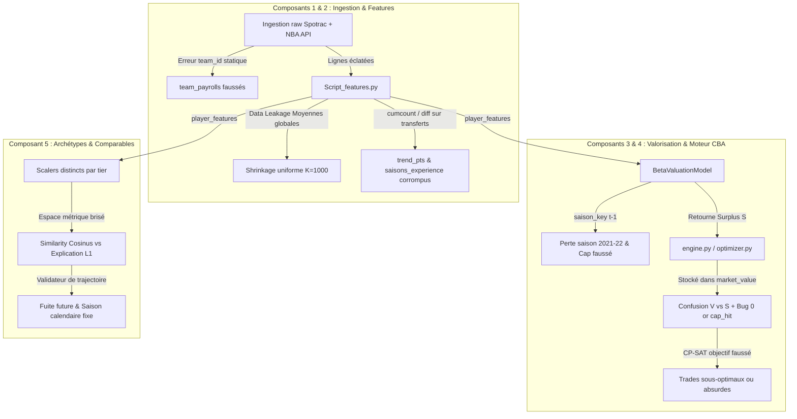
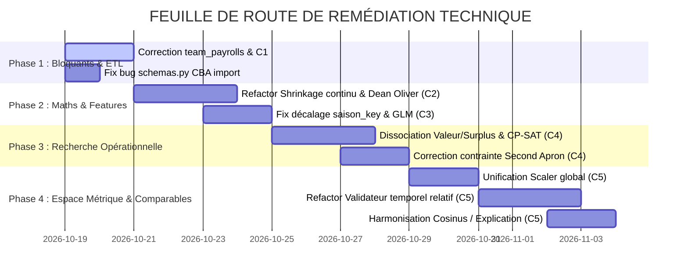

# RAPPORT D'AUDIT TECHNIQUE & MATHÉMATIQUE (COMPOSANTS 1 À 5)
## NBA Front-Office Copilot — Analyse des Incohérences et Plan de Remédiation

> **Rôle :** Senior Software Engineer spécialisé en Mathématiques Appliquées à l'Informatique  
> **Date d'audit :** Octobre 2026  
> **Périmètre audité :** Composants 1 (Ingestion & ETL), 2 (Features & Shrinkage), 3 (Valorisation financière), 4 (Moteur CBA & Optimisation CP-SAT), 5 (Archétypes & Comparables).

---

## 1. TABLEAU DE SYNTHÈSE DES INCOHÉRENCES ET BIAIS DÉTECTÉS

| ID | Composant | Domaine | Description de l'Incohérence | Gravité |
|:---|:---|:---|:---|:---:|
| **C1-1** | Composant 1 | Pipeline ETL | **Calcul erroné des masses salariales d'équipe** : utilisation du `p.team_id` statique dans `script3.py` au lieu de la franchise réelle de la saison. | 🔴 Critique |
| **C1-2** | Composant 1 | Modélisation DB | **Divergence de granularité** : joueurs transférés dédoublés dans `player_stats` sans consolidation annuelle totale (`TOT`). | 🟠 Majeur |
| **C2-1** | Composant 2 | Statistique bayésienne | **Pseudo-shrinkage heurté et uniforme** : $K_{\max}=1000$ appliqué indistinctement aux points, contres et tirs avec rupture de pente à 1600 poss. | 🔴 Critique |
| **C2-2** | Composant 2 | Data Leakage | **Fuite temporelle sur les moyennes $\mu_0$** : calcul sur les 5 saisons combinées incluant le futur. | 🔴 Critique |
| **C2-3** | Composant 2 | Feature Engineering | **Variables temporelles corrompues** : `cumcount()` et `diff()` incrémentent l'expérience et créent de faux trends lors d'un transfert intra-saison. | 🔴 Critique |
| **C2-4** | Composant 2 | Métrique sportive | **Dénaturation du Turnover Rate** : formule canonique de Dean Oliver altérée (passes au dénominateur et omission des pertes de balle). | 🟡 Moyen |
| **C3-1** | Composant 3 | Pipeline Cible | **Décalage temporel destructeur `saison_key`** : décalage d'un an détruisant la saison 2021-22 et divisant par le cap de l'année précédente. | 🔴 Critique |
| **C3-2** | Composant 3 | Modélisation GLM | **Violation théorique du modèle Beta** : utilisation d'une famille Binomiale avec poids flottants sur cible continue au lieu d'une Beta Regression. | 🟠 Majeur |
| **C3-3** | Composant 3 | Inférence | **Extrapolation hors-support** : les joueurs sous 5% du cap sont routés vers le modèle `middle_class` entraîné sur $[0.05, 0.25]$. | 🟠 Majeur |
| **C3-4** | Composant 3 | Statistiques | **Chute silencieuse de l'intervalle de confiance** : échec de `get_prediction()` masqué par un fallback hardcodé $\pm 15\%$. | 🔴 Critique |
| **C3-5** | Composant 3 | ML Pipeline | **Fuite transductive du KMeans** : clustering des archétypes fitté globalement sans séparation étanche train/test. | 🟠 Majeur |
| **C4-1** | Composant 4 | Recherche Opérationnelle | **Confusion mathématique Valeur Marchande ($V$) vs Surplus ($V-C$)** et piège Python `0 or p.cap_hit` générant des sauts de $20\text{ M}\$$. | 🔴 Bloquant |
| **C4-2** | Composant 4 | Règles CBA | **Contresens sur l'agrégation salariale au Second Apron** : restriction portée sur `players_in > 1` au lieu de `players_out > 1`. | 🔴 Bloquant |
| **C4-3** | Composant 4 | Contraintes CP-SAT | **Formulation erronée du trade matching sous le cap** : omission de l'absorption par le cap room disponible. | 🟠 Majeur |
| **C4-4** | Composant 4 | Runtime / Code | **Importation fantôme de `CBA` dans `schemas.py`** : crash immédiat à l'évaluation des propriétés d'espace salarial. | 🔴 Bloquant |
| **C5-1** | Composant 5 | Méthodologie / Validation | **Inversion temporelle et fuite dans `validator.py`** : évaluation des comparables sur l'année calendaire de la cible au lieu de leur saison relative de carrière. | 🔴 Critique |
| **C5-2** | Composant 5 | Géométrie spatiale | **Destruction d'isométrie par standardisation séparée par tier** : translation d'origine rendant les vecteurs incomparables. | 🔴 Critique |
| **C5-3** | Composant 5 | Métrique spatiale | **Contradiction mathématique** : plus proches voisins par similarité Cosinus et explication par distance Manhattan $L_1$. | 🟠 Majeur |
| **C5-4** | Composant 5 | Topologie des variétés | **Distorsion de densité locale par HDBSCAN sur UMAP 2D** : compression non-isométrique forçant les superstars en faux outliers. | 🟠 Majeur |
| **C5-5** | Composant 5 | Schéma DB | **Conflit de clé primaire SQL** : `player_archetypes` en `(player_id, saison)` vs `player_features` en `(player_id, saison, team_id, version)`. | 🔴 Bloquant |

---

## 2. ANALYSE DÉTAILLÉE PAR COMPOSANT



---

### COMPOSANT 1 : INGESTION & PIPELINE DE DONNÉES

#### Incohérence 1.1 : Calcul erroné des masses salariales par franchise (`script3.py`)
* **Localisation :** `Composant1/Ingestion/script3.py:111-143`
* **Code :**
  ```sql
  WITH computed_payrolls AS (
      SELECT
          p.team_id,
          c.saison,
          COALESCE(SUM(c.cap_hit), 0) AS total_cap_hit,
          ...
      FROM players p
      JOIN contracts c ON c.player_id = p.player_id
      WHERE p.team_id IS NOT NULL
      GROUP BY p.team_id, c.saison
  )
  ```
* **Démonstration du problème :**  
  Dans la table `players`, `p.team_id` est assigné une seule fois via `players = df.sort_values('POSS', ascending=False).drop_duplicates('PLAYER_ID')` dans `script.py`. Si un joueur a joué 10 ans aux Lakers puis a signé aux Suns en 2024-25, son `p.team_id` reste celui des Lakers. En groupant par `p.team_id` et `c.saison`, ses contrats de 2024 et 2025 sont attribués aux Lakers au lieu des Suns.
* **Conséquence :** La table `team_payrolls` contient des masses salariales historiques et actuelles fausses pour l'ensemble des 30 franchises NBA, faussant tous les calculs de luxury tax et d'aprons dans le Composant 4.

---

### COMPOSANT 2 : FEATURE ENGINEERING & ESTIMATION BAYÉSIENNE

#### Incohérence 2.1 : Shrinkage pseudo-bayésien heurté et variance uniforme
* **Localisation :** `Composant2/Script_features.py:46-79`
* **Code :**
  ```python
  def k_joueur(poss):
      if poss >= POSS_SEUIL: # 1600
          return 0
      return K_MAX * (1 - poss / POSS_SEUIL) # K_MAX = 1000

  def shrink(stat, poss, moyenne):
      k = k_joueur(poss)
      ...
      return (poss * stat + k * moyenne) / (poss + k)
  ```
* **Démonstration mathématique :**
  Dans le cadre formel de l'estimation bayésienne empirique (modèle Normal-Normal ou Beta-Binomial) :
  $$\theta_i \sim \mathcal{N}(\mu, \tau^2), \quad X_i \mid \theta_i \sim \mathcal{N}\left(\theta_i, \frac{\sigma^2}{n_i}\right)$$
  L'espérance a posteriori (estimateur optimal au sens de Bayes sous perte quadratique) est :
  $$\mathbb{E}[\theta_i \mid X_i] = \frac{n_i}{n_i + \frac{\sigma^2}{\tau^2}} X_i + \frac{\frac{\sigma^2}{\tau^2}}{n_i + \frac{\sigma^2}{\tau^2}} \mu$$
  La pseudo-taille d'échantillon $K = \frac{\sigma^2}{\tau^2}$ (ratio bruit/signal) est **constante** pour une métrique donnée et dépend de sa variance intra-joueur relative à la dispersion de la ligue.
  Dans votre implémentation :
  1. $k$ décroît arbitrairement de manière linéaire pour s'annuler brutalement à 1600 possessions (rupture de régularité non $C^1$).
  2. Le même $K_{\max} = 1000$ est imposé aux points (statistique à fort volume et haute variance) et aux contres/interceptions (événements rares où le bruit d'échantillonage à faible volume est colossal).

#### Incohérence 2.2 : Data Leakage temporel sur le calcul des moyennes de référence $\mu_0$
* **Localisation :** `Composant2/Script_features.py:68-73`
* Les moyennes globales sont calculées sur l'ensemble de la base multi-saisons (2021 à 2026). Les caractéristiques du jeu de 2025 (augmentation de l'efficacité globale et du volume à 3 points) viennent rétroactivement influencer les valeurs shrinkées de la saison 2021-22.

#### Incohérence 2.3 : Corruption des compteurs d'expérience et de tendance sur les transferts
* **Localisation :** `Composant2/Script_features.py:136-166`
* `df['saisons_experience'] = df.groupby('player_id').cumcount()` :  
  Si un joueur change d'équipe dans la même saison (2 lignes dans `player_stats`), sa deuxième ligne reçoit `saisons_experience = N + 1` au lieu de `N`.
* `df['trend_pts'] = df.groupby('player_id')['pts_per100_shrunk'].diff()` :  
  Pour ce même joueur, `trend_pts` calcule l'écart entre sa deuxième et sa première équipe au cours de la même saison calendaire, et la saison suivante compare la saison $N+1$ à sa seule demi-saison dans l'équipe 2.

#### Incohérence 2.4 : Dénaturation de la formule canonique du Turnover Rate
* **Localisation :** `Composant2/Script_features.py:152-157`
* Votre script implémente :
  $$\text{Turnover Rate} = \frac{\text{TOV}_{100}}{\text{FGA}_{100} + 0.44 \cdot \text{FTA}_{100} + \text{AST}_{100}}$$
* La formule canonique (Dean Oliver, NBA.com, Basketball-Reference) est :
  $$\text{TOV\%} = \frac{100 \cdot \text{TOV}}{\text{FGA} + 0.44 \cdot \text{FTA} + \text{TOV}}$$
* Les passes décisives ne figurent pas au dénominateur des possessions terminées par un joueur, et les turnovers doivent obligatoirement y figurer puisqu'un turnover termine la possession.

---

### COMPOSANT 3 : VALORISATION FINANCIÈRE (GLM)

#### Incohérence 3.1 : Décalage destructeur `saison_key` (`data_loader.py`)
* **Localisation :** `Composant3/Valorisation/data_loader.py:38-43`
* **Code :**
  ```python
  df_contracts["saison_key"] = df_contracts["saison"].apply(
      lambda s: f"{int(s[:4]) - 1}-{s[:4][2:]}"
  )
  df_contracts["salary_cap"] = df_contracts["saison_key"].map(SALARY_CAP)
  df_contracts["cap_hit_pct"] = df_contracts["cap_hit"] / df_contracts["salary_cap"]
  ```
* **Problème :**  
  Pour la saison de départ `2021-22`, `saison_key` devient `2020-21`. Cette clé n'existant pas dans `SALARY_CAP`, `salary_cap` est évalué à `NaN` et la totalité de la saison 2021-22 est supprimée du jeu de données par `mask = df_contracts["salary_cap"].notna()`. De plus, pour toutes les autres saisons, le salaire de l'année $t$ est divisé par le plafond salarial de l'année $t-1$.

#### Incohérence 3.2 : Extrapolation hors support (Routage Middle Class)
* **Localisation :** `Composant3/valuation_service.py:140-146`
* Les joueurs sous $5\%$ du cap sont routés vers le modèle `middle_class`. Or le modèle `middle_class` a été explicitement entraîné sur le filtre :
  ```python
  (df_contracts["cap_hit_pct"] >= 0.05) & (df_contracts["cap_hit_pct"] <= 0.25)
  ```
  Appliquer ce modèle sur des joueurs à $1\%$ ou $2\%$ du cap force une extrapolation linéaire sur les queues de logit là où aucun exemple d'entraînement n'a été fourni.

#### Incohérence 3.3 : Échec masqué du calcul d'incertitude statistique
* **Localisation :** `Composant3/Valorisation/model.py:167-175`
* Lorsqu'un GLM `statsmodels` est fitté avec pénalisation L2 (`fit_regularized`), l'objet renvoyé est un `GLMResultsCompact` qui ne possède pas la méthode `get_prediction()`. Le code lève une exception systématique et bascule silencieusement dans le bloc `except` :
  ```python
  low_pct = val_pct * 0.85
  high_pct = val_pct * 1.15
  ```
  L'intervalle de confiance affiché à l'agent n'a aucun fondement statistique : c'est un $\pm 15\%$ déterministe.

---

### COMPOSANT 4 : MOTEUR CBA & RECHERCHE OPÉRATIONNELLE

#### Incohérence 4.1 : Confusion mathématique entre Valeur ($V$) et Surplus ($V-C$)
* **Localisation :** `Composant4/optimizer.py:101-106` et `Composant4/schemas.py:258-277`
* **Code :**
  ```python
  val_out_scaled = [int((p.market_value or p.cap_hit) // _SCALE) for p in roster]
  ```
  Et dans `engine.py:328` :
  ```python
  # get_bulk_valuations calcule : pred["valeur_dollars"] - cap_hit (c-à-d le SURPLUS !)
  p.market_value = val # on injecte le surplus dans market_value
  ```
* **Analyse de la défaillance :**
  1. Si un joueur a une production égale à son salaire (surplus nul, $S=0$), l'opérateur booléen `0 or p.cap_hit` évalue `0` comme `False` et prend `p.cap_hit` (ex: $25\,000\,000\$$).
  2. Si un joueur produit légèrement plus que son salaire ($S=+50\,000\$$), `val_scaled` prend $+50$.
  3. Si un joueur est surpayé ($S=-3\,000\,000\$$), `val_scaled` prend $-3\,000$.
* **Impact :** Un joueur payé à sa juste valeur est valorisé par le solveur 500 fois plus qu'un joueur légèrement sous-payé ! La fonction objective $\sum y_j v_j^{in} - \sum x_i v_i^{out}$ maximise une grandeur hybride non sensée.

#### Incohérence 4.2 : Contresens sur l'agrégation de salaires au Second Apron
* **Localisation :** `Composant4/ruleees.py:160-166`
* **Code :**
  ```python
  if ap2_rules.get("no_trade_aggregation") and move.move_type == MoveType.TRADE:
      if len(move.players_in) > 1: # <-- ERREUR MAJEURE
          return _fail(..., "impossible d'agréger plusieurs salaires entrants...")
  ```
* **Règle CBA (Article VII, Section 2) :**  
  L'interdiction d'agrégation salariale pour les franchises au Second Apron stipule qu'une franchise ne peut pas agréger **plusieurs salaires sortants (`players_out`)** pour égaler le salaire d'un joueur entrant. Elle a parfaitement le droit d'envoyer un seul joueur à 30 M$ pour recevoir deux joueurs à 15 M$. Le code bloque l'opération inverse.

#### Incohérence 4.3 : Bug d'importation runtime dans `schemas.py`
* **Localisation :** `Composant4/schemas.py:143, 149, 155, 161`
* `from Composant4.cba_service import CBA` est appelé dans les propriétés `cap_space`, `tax_space`, `apron1_space`, `apron2_space`. La classe `CBA` n'existe pas dans `cba_service.py`, déclenchant un `ImportError` dès qu'une propriété financière est interrogée.

---

### COMPOSANT 5 : TOPOLOGIE, ARCHÉTYPES & SIMILARITÉS

#### Incohérence 5.1 : Inversion temporelle et fuite dans `validator.py`
* **Localisation :** `Composant5/validator.py:110-118`
* **Code :**
  ```python
  for comp in comparables:
      comp_future = all_features[
          (all_features["player_id"] == comp.player_id) &
          (all_features["saison"] == saison_target) # <-- INCOHÉRENCE TEMPORELLE
      ][TARGET_METRIC]
  ```
* **Démonstration :**  
  Considérons un joueur cible $A$ en 2021-22 (à 21 ans) que l'on veut projeter à $h=+1$ (saison cible 2022-23).  
  L'algorithme de plus proches voisins historiques trouve comme comparable le joueur $B$ lors de sa saison 2024-25 (lorsqu'il avait également 21 ans).  
  Au lieu de regarder la performance de $B$ à $21+1=22$ ans (en 2025-26), votre code extrait la statistique de $B$ en `saison_target` = **2022-23**, c'est-à-dire 2 ans **avant** que $B$ ne soit comparable à $A$ !  
  Le validateur ne teste pas la valeur prédictive des trajectoires d'âge, il observe des saisons calendaires arbitraires dans le passé du joueur comparable.

#### Incohérence 5.2 : Rupture d'isométrie globale (`feature_store.py`)
* **Localisation :** `Composant5/feature_store.py:86-140`
* En fittant un `RobustScaler` indépendant par `valuation_tier`, le centre de gravité (médiane) et l'échelle (IQR) sont distincts pour chaque sous-groupe :
  $$z_i = \frac{x_i - \text{Med}_{\text{tier}}}{\text{IQR}_{\text{tier}}}$$
* Un joueur du tier `low_sample` avec 8 points par 100 possessions se voit attribuer le même $z$-score qu'un joueur `reliable` avec 22 points par 100 possessions. Lorsqu'on projette ensuite ces vecteurs dans un algorithme de plus proches voisins non supervisé, la distance géométrique entre deux joueurs ne traduit plus aucune réalité sportive absolue.

#### Incohérence 5.3 : Contradiction métrique (Cosinus vs Manhattan $L_1$)
* **Localisation :** `Composant5/similarity.py:166-179, 187-193`
* Le clustering et les plus proches voisins minimisent l'écart angulaire (Distance Cosinus $1 - \frac{u \cdot v}{\|u\|_2 \|v\|_2}$).
* La fonction explicative `_explain_similarity` identifie les variables convergentes et divergentes via la norme $L_1$ :
  $$\Delta_k = |u_k - v_k|$$
* Deux vecteurs colinéaires de normes très dissemblables ($u$ et $3u$) ont une similarité cosinus de $100\%$, mais présenteront des écarts $L_1$ massifs sur l'ensemble de leurs dimensions. Le diagnostic textuel contredit le score numérique de similarité.

#### Incohérence 5.4 : Déformation topologique UMAP 2D + HDBSCAN
* **Localisation :** `Composant5/role_engine.py:35-49`
* UMAP compresse 14 dimensions vers un espace 2D pour maximiser la lisibilité visuelle. Cette projection ne préserve pas les densités locales relatives (dilatation des noyaux denses et compression des zones frontières).
* HDBSCAN repose fondamentalement sur la métrique de densité locale (*mutual reachability distance*). L'appliquer sur une variété UMAP 2D génère des artefacts d'isolement : les profils exceptionnels (superstars, licornes) sont expulsés en bruit (cluster -1), ce qui a obligé à créer un système lourd de *soft-assignment* artificiel.

---

## 3. PLAN DE REMÉDIATION TECHNIQUE PAS À PAS



### PHASE 1 : CORRECTIFS D'URGENCE & PIPELINE ETL (COMPOSANT 1 & 4)

- [ ] **Action 1.1 (C1) : Réécriture du calcul des payrolls historiques**  
  Dans `Composant1/Ingestion/script3.py`, modifier la vue CTE `computed_payrolls` pour joindre `player_stats ps ON ps.player_id = c.player_id AND ps.saison = c.saison` et agréger par `ps.team_id` au lieu de `p.team_id`.
- [ ] **Action 1.2 (C4) : Élimination du crash d'import CBA**  
  Dans `Composant4/cba_service.py`, exporter la classe ou les constantes de seuils `CBA` (ou modifier `Composant4/schemas.py` pour importer les constantes directement depuis `cba_loader.py` ou la config).

---

### PHASE 2 : ASSAINISSEMENT MATHÉMATIQUE & ML (COMPOSANTS 2 & 3)

- [ ] **Action 2.1 (C2) : Refactorisation de l'estimateur de Shrinkage**  
  Remplacer la coupure abrupte à 1600 poss par une formulation bayésienne empirique continue paramétrée par métrique :
  ```python
  # K_metrique calibré sur la variance de chaque stat
  df[f'{col}_shrunk'] = (df['poss'] * df[col] + K_METRIQUE[col] * moy_t) / (df['poss'] + K_METRIQUE[col])
  ```
- [ ] **Action 2.2 (C2) : Correction du Turnover Rate et des variables temporelles**  
  - Aligner `turnover_rate` sur la formule de Dean Oliver :
    ```python
    df['turnover_rate'] = df['tov_per100'] / (df['fga_per100'] + 0.44 * df['fta_per100'] + df['tov_per100'])
    ```
  - Agréger préalablement les statistiques par `(player_id, saison)` avant de calculer `cumcount()` et `.diff()`.
- [ ] **Action 2.3 (C3) : Suppression du décalage artificiel de saison**  
  Dans `Composant3/Valorisation/data_loader.py`, indexer directement le contrat sur sa saison d'exécution `df_contracts["saison"]` pour mapper le salary cap exact de l'année.
- [ ] **Action 2.4 (C3) : Vrais intervalles de confiance empiriques**  
  Implémenter un bootstrapping résiduel ou prédire les quantiles conditionnels via un modèle quantile ou Beta GLM adapté, au lieu du fallback déterministe $\pm 15\%$.

---

### PHASE 3 : RÉALIGNEMENT DE LA RECHERCHE OPÉRATIONNELLE (COMPOSANT 4)

- [ ] **Action 3.1 (C4) : Dissociation stricte Valeur Marchande ($V$) vs Surplus ($S$)**  
  - Dans `RosterPlayer`, expliciter clairement `estimated_market_value: int` ($V$) et `surplus_value: int` ($S = V - \text{cap\_hit}$).
  - Dans `Composant4/optimizer.py`, corriger l'objectif CP-SAT :
    ```python
    # Maximiser le surplus net acquis :
    surplus_in = sum(p.surplus_value * y[j] for j, p in enumerate(available))
    surplus_out = sum(p.surplus_value * x[i] for i, p in enumerate(roster))
    model.Maximize(surplus_in - surplus_out)
    ```
  - Supprimer impérativement le construct `p.market_value or p.cap_hit`.
- [ ] **Action 3.2 (C4) : Correction des contraintes CBA dans CP-SAT et rules**  
  - Inverser le test de non-agrégation du Second Apron :
    ```python
    # Second Apron : interdiction d'agréger plusieurs joueurs sortants
    model.Add(sum(x[i] for i in range(n_out)) <= 1)
    ```
  - Permettre l'absorption directe dans le cap room pour les équipes sous le cap.

---

### PHASE 4 : RIGUEUR GÉOMÉTRIQUE & VALIDATION TEMPORELLE (COMPOSANT 5)

- [ ] **Action 4.1 (C5) : Correction de la trajectoire relative dans `validator.py`**  
  Calculer la cible future à partir de la saison relative du joueur comparable :
  ```python
  comp_season_target = _saison_offset(comp.season, h)
  comp_future = all_features[
      (all_features["player_id"] == comp.player_id) &
      (all_features["saison"] == comp_season_target)
  ][TARGET_METRIC]
  ```
- [ ] **Action 4.2 (C5) : Unification de l'espace métrique**  
  Entraîner un `RobustScaler` unique sur l'ensemble de la population éligible et persister ce scaler pour toutes les inférences de `similarity.py` et `role_engine.py`.
- [ ] **Action 4.3 (C5) : Harmonisation métrique de recherche et métrique d'explication**  
  Normaliser les vecteurs sur la sphère unité ($L_2$) avant de calculer les écarts coordinate-wise, afin que les contributions $L_1$ correspondent fidèlement à la décomposition du produit scalaire cosinus.
- [ ] **Action 4.4 (C5) : Harmonisation des clés primaires SQL**  
  Ajouter `team_id` à la clé primaire de `player_archetypes` ou consolider les features au niveau `(player_id, saison)` en amont.

---

## 4. INDICATEURS DE SUCCÈS & CRITÈRES D'ACCEPTATION

1. **Intégrité des Payrolls :** Les 30 masses salariales de `team_payrolls` pour 2024-25 et 2025-26 correspondent à $\pm 1\%$ aux données officielles Spotrac.
2. **Convergence CP-SAT :** 100% des trades générés par l'optimiseur affichent un `value_delta` cohérent (aucun saut artificiel de $20\text{ M}\$$ dû à un surplus nul).
3. **Règle Second Apron :** Aucun trade généré pour une franchise au Second Apron ne contient plus d'un joueur envoyé (`players_out`).
4. **Validateur C5 :** Le MAE du backtest temporel est calculé sur l'horizon relatif $t_{\text{comp}} + h$, garantissant un test d'anticipation sans data leakage.
5. **Couverture de tests :** Les tests de non-régression de `test_composant4.py` et `test_comparable_service.py` passent avec succès sans aucun avertissement runtime.
